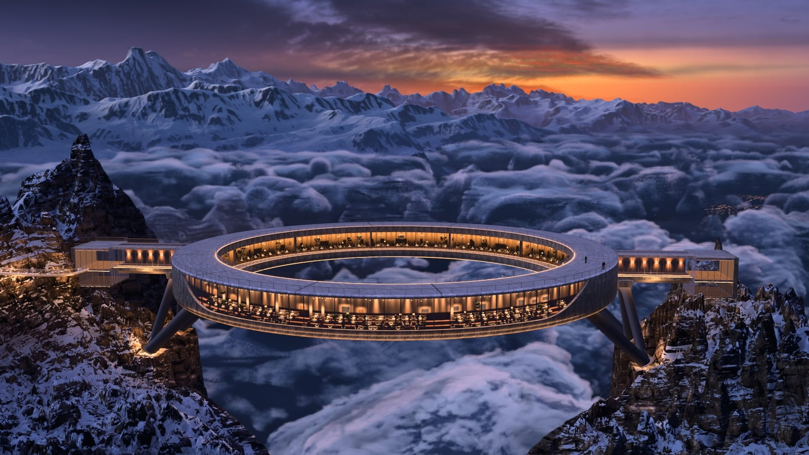
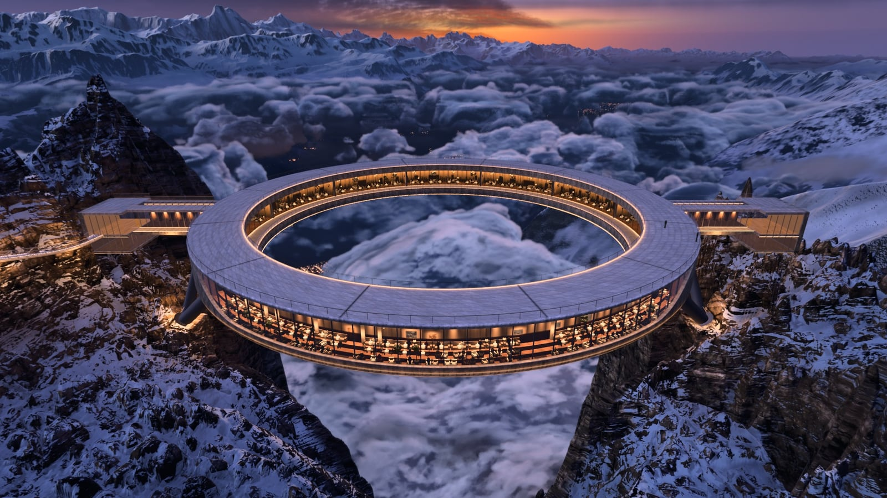
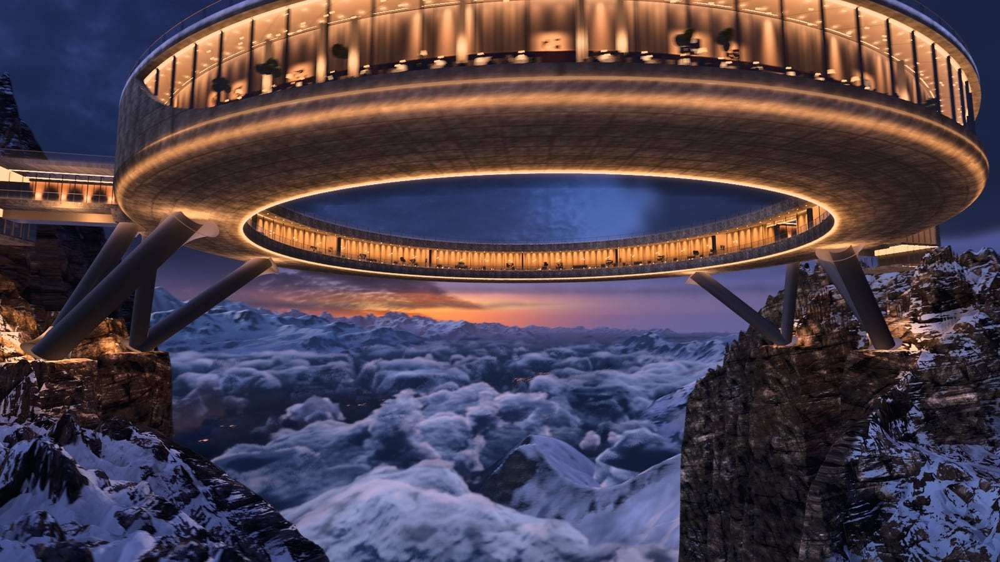
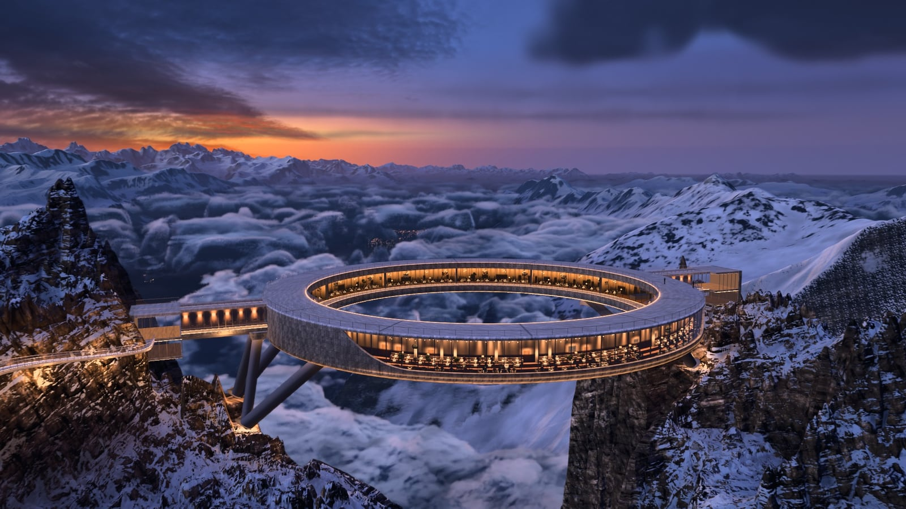

# Halo Above the Clouds

A concrete ring restaurant hanging between two snowy dolomite pinnacles at blue hour, above a sea of clouds, with
Lake Brienz and the Bernese Alps below. It is a real-time Three.js scene (r187, WebGL2), and a 45 s drone film rendered
offline from that same scene.



**[Watch the film (45 s, 1080p30, MP4)](https://github.com/Leonxlnx/halo-above-the-clouds/releases/download/v1.0/halo_film_1080p30.mp4)**

The scene was built by Claude Code (Claude Opus 5.5) from 11 AI-generated reference images, with several agents
working in parallel on terrain, rock and snow, clouds, sky, structure and the film. Every frame of the film is
rendered from the 3D scene. No reference image is projected into it.

| | |
|---|---|
|  |  |

## Run it

You need Node 22.12+ and a GPU with WebGL2.

```bash
npm install
npm run data     # downloads the baked scene data (~0.3 GB) into data/
npm run dev
```

Open http://localhost:5173. The first load can take a few minutes while the shaders compile.

- **Drag** to orbit and **scroll** to zoom.
- **1–9, 0, −** jump to the camera views.
- **V** plays the film's camera path in real time. Press it again to stop.
- Add `?noclouds` to the URL on a weaker GPU.

## What is in the scene

- **Terrain** (`tools/terrain.mjs`, `src/terrain.js`, `src/glsl/rock.js`)
  - Real elevation data around the Brienzer Rothorn (46.787 N, 8.047 E).
  - Nested levels, from far to near:
    - a polar far level reaching about 240 km from the ring (`tools/fardem.mjs`)
    - a 50 km level
    - a 4–12 km mid level (`tools/farmid.mjs`)
    - an 8 km level
    - a hand-sculpted 1.6 km near field with the two pinnacles
    - a fine level with 0.39 m cells around the ring
  - A crest pass sharpens the Alpine summits (`tools/farsummit.mjs`).
  - Baked sky visibility, horizon AO and key-light shadows (`tools/farkey.mjs`).
  - Snow and rock shading on top of Poly Haven textures.
- **Ring** (`src/structure.js`, `src/glsl/structure.js`)
  - 110 m across, with a roof deck, a glazed restaurant ring with an inner terrace, and V-struts.
  - Two bridges with glass pavilions and a cliff path.
  - Analytic LED and window light on the concrete.
- **Clouds** (`src/clouds.js`): a volumetric raymarch of a curved cloud sea. It runs at half resolution for film
  frames and quarter resolution in the interactive viewer. Shape, billow, curl and detail noise volumes come from
  `tools/noise3d.mjs`, `tools/noise_billow.mjs` and `tools/noise_curl.mjs`. Light from the towns glows up from
  underneath.
- **Sky** (`tools/skybake.mjs`, `src/sky.js`, `src/glsl/common.js`, `src/glsl/far.js`)
  - A photo sky dome baked from CC0 HDRIs.
  - Twilight aerial perspective.
  - Shading for the distant ranges.
- **Valley** (`tools/lights.mjs`, `src/lights.js`, `src/glsl/water.js`): about 117k village and road lights, with
  reflections on the lake.
- **Post** (`src/post.js`): HDR bloom, a filmic grade with toe and shoulder, and grain.
- **Film** (`src/timeline.js`): 11 free-flight shots with roll, cuts, a fade-in and a fade-out.

`src/matte.js` can project the reference images onto far regions for stills. The reference images are not in this
repo, so the matte is skipped. The film does not use it. For the same reason, the tools that compare against the
references (`gradetune.mjs`, `matte_*.mjs` and the comparison in `shot.mjs`) need your own images in `ref/`.

## Render the film



The renderer drives headless Chrome through `puppeteer-core`. It is set up for Chrome on Windows; set `CHROME` to the
browser's path anywhere else. Encoding needs `ffmpeg` (with libx264) on your PATH.

```bash
npm run dev                                            # keep running in a second terminal
node tools/render.mjs --out out/frames --w 1920 --h 1080 --K 8 --jpg
powershell -File tools/encode.ps1 -Frames out/frames -Ext jpg -Audio music.wav
```

- **Sub-frames:** `--K` sets how many jittered sub-frames are averaged into each frame. More sub-frames give smoother
  antialiasing and motion blur. `--shutter` sets the blur length (default 0.5 of a frame). K 1 has no blur.
- **Audio:** `encode.ps1` stops at whichever ends first, the frames or the audio, so trim the track to 45 s and fade
  it out first.
- **Speed:** at K 8 the film took about 5 s per frame on a laptop Radeon 780M, so roughly 2 h for all 1350 frames.
- **Resuming:** `render.mjs` skips frames that already exist, so you can stop it and pick up later. Use `--times 2,15.5`
  to render only the frames at those film times.
- **GPU lock:** renders take a lock file in the temp folder (`tools/gpulock.mjs`, override with `GPU_LOCK`), so only
  one headless renderer uses the GPU at a time.

## Rebuild the data

`npm run data` is all you need to run the scene. To rebuild the data from scratch:

```bash
node tools/terrain.mjs --refetch   # fetch the DEM, sculpt the near field, bake AO
node tools/lights.mjs              # village and road lights
node tools/fardem.mjs              # polar far level
node tools/farmid.mjs              # 4-12 km mid level
node tools/farsummit.mjs --lf      # summit and crest pass
node tools/farkey.mjs              # key-light shadows for the far ranges
node tools/noise3d.mjs             # cloud shape, detail and weather noise
node tools/noise_billow.mjs
node tools/noise_curl.mjs
node --max-old-space-size=14000 tools/skybake.mjs   # sky dome, needs ~5 GB RAM
```

Run them in this order. `terrain.mjs` rewrites `data/terrain/meta.json`, and the far tools add their levels to it.

The sky dome is baked from two Poly Haven HDRIs. Download both at 8k before baking:

- *Belfast Sunset (Pure Sky)* to `data/sky/src/belfast_sunset_puresky_8k.hdr`
- *Cedar Bridge Sunset 1* to `data/sky/src_cedar/cedar_bridge_sunset_1_8k.hdr`

No tool downloads the textures in `data/tex`. They are 2k Poly Haven sets (`cliff_side`, `marble_cliff_03`,
`rock_face_03`, `snow_02`, `concrete_wall_006` and a few spares) and come with `npm run data`.

## Credits

- **Code:** MIT, see [LICENSE](LICENSE).
- **Elevation:** [AWS Terrain Tiles](https://registry.opendata.aws/terrain-tiles/) (Mapzen / Tilezen). It includes
  EU-DEM, produced using Copernicus data and information funded by the European Union, as well as SRTM, GMTED2010 and
  ETOPO1. See the
  [full attribution](https://github.com/tilezen/joerd/blob/master/docs/attribution.md).
- **Textures and sky HDRIs:** [Poly Haven](https://polyhaven.com), CC0.
- **Music in the film:** "Uprising" by Scott Buckley (www.scottbuckley.com.au), licensed under
  [CC BY 4.0](https://creativecommons.org/licenses/by/4.0/). It was edited to 45 s with a fade-out.
- **Libraries:** [three.js](https://threejs.org).
